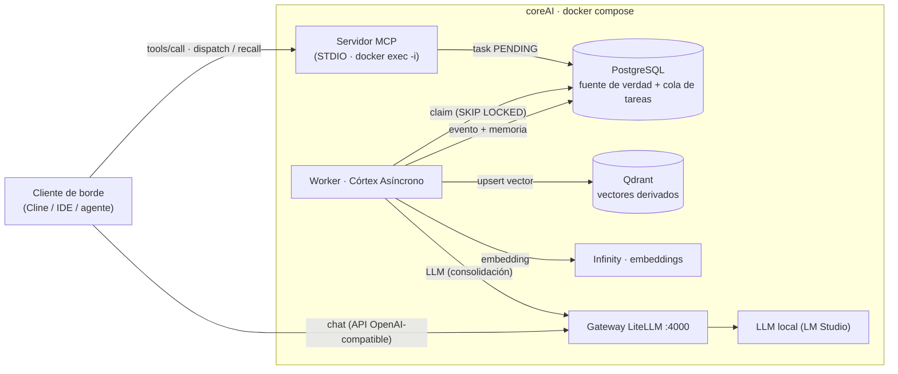

# coreAI

**Sustrato local-first de orquestación LLM sobre Model Context Protocol (MCP).** Todo on-premise y empaquetado en Docker: PostgreSQL como fuente de verdad relacional, Qdrant como memoria vectorial derivada, un gateway LiteLLM para el plano de modelos y un córtex asíncrono que procesa las tareas de fondo. Los clientes — IDEs, agentes, clientes de borde — *brotan* del sustrato a través de MCP.

> coreAI es un **sustrato, no un cerebro**: el gateway enruta, no piensa; la orquestación interactiva vive en el cliente de borde; coreAI garantiza persistencia, memoria unificada y procesamiento de fondo.

## Principios arquitectónicos

- **Local-first / on-premise** — sin dependencia de nube; la soberanía de datos es parte del diseño, no un añadido.
- **100 % Docker** — el stack completo se levanta con un `docker compose up -d`.
- **Toda interacción externa es vía MCP** — sin REST, sin WebSockets, sin UI propia: los clientes consumen tools.
- **Memoria unificada** — PostgreSQL (UUIDs, entidades/eventos/relaciones) es la fuente de verdad; Qdrant contiene vectores derivados: nunca texto sin respaldo relacional.
- **Ingesta unificada (ADR-005)** — una única apertura de escritura, `coreai_dispatch_task`: las escrituras son eventos que el córtex procesa en asíncrono; la lectura síncrona acotada (`coreai_search_context`, en camino) es la única otra apertura.
- **Contratos de tarea (ADR-006)** — cada tipo de tarea despachable lleva contrato formal registrado: *sin contrato no hay despacho*.
- **Córtex asíncrono sin broker** — cola de tareas sobre PostgreSQL con `SELECT ... FOR UPDATE SKIP LOCKED`.

## Arquitectura



| Servicio | Contenedor | Puerto | Función |
|---|---|---|---|
| postgres | `coreai_postgres` | 5432 | Fuente de verdad relacional + cola de tareas (`pgvector/pgvector:pg15`) |
| qdrant | `coreai_qdrant` | 6333 | Memoria vectorial derivada (colecciones por dominio) |
| litellm | `coreai_litellm` | 4000 | Gateway OpenAI-compatible: enrutado de modelos, logs y métricas |
| infinity | `coreai_infinity` | 8080 | Embeddings locales (modelos servidos desde `/data`) |
| core-mcp | `coreai_mcp` | — | Lanzadera: el servidor MCP se spawnea por cliente vía `docker exec -i` (STDIO, sin red) |
| worker-node | `coreai_worker` | — | Córtex asíncrono: reclama tareas y ejecuta los handlers |
| adminer | `coreai_adminer` | 8081 | Administración de la base de datos |
| loki / prometheus / grafana | `coreai_loki` / `coreai_prometheus` / `coreai_grafana` | 3100 (solo loopback) / — / 3000 | Observabilidad: logs, métricas y dashboards |

## Arranque rápido

```bash
# 1. Variables de entorno
cp .envExample .env    # revisa POSTGRES_URL y credenciales

# 2. Stack completo
docker compose up -d

# 3. Tests (requieren la BD de test: el conftest aborta si la URL no apunta a coreai_test_db)
pytest
```

**Prerrequisitos:**
- Docker + Docker Compose.
- Modelos: Infinity sirve embeddings desde `/data` (ver `scripts/prepare_model.py`); el chat apunta al gateway LiteLLM (`:4000`, config en `src/config/litellm_config.edge.yaml`), que enruta hacia tu modelo local.

**Conectar un cliente MCP** (ej. Cline, `cline_mcp_settings.json`):

```json
{
  "mcpServers": {
    "coreai": {
      "command": "docker",
      "args": ["exec", "-i", "coreai_mcp", "python", "-m", "src.main"]
    }
  }
}
```

> La `-i` es imprescindible: sin ella stdin no se conecta y el servidor muere de EOF (el cliente ve 0 tools).

## Superficie MCP actual

| Tool | Estado | Descripción |
|---|---|---|
| `coreai_dispatch_task` | ✅ Operativa | Única apertura de escritura: inyecta una tarea asíncrona (contrato del tipo obligatorio — ADR-006) con auto-vivificación de sesión/entidad si no se aportan IDs. |
| `coreai_search_context` | 🚧 En camino | Lectura síncrona read-only (ADR-005-002): la única otra apertura del sustrato, para rutas request-response en milisegundos. |

## Mapa del repositorio

```
src/
  config/        # litellm_config.edge.yaml, provisioning de Prometheus/Grafana
  contracts/     # Registro central de contratos de tarea (ADR-006-001)
  db/            # SQLAlchemy: modelos, sesiones, repositorios (relacional + vectorial)
  managers/      # TaskManager, HybridMemoryManager, LLMClient, ConfigManager
  mcp/tools/     # Superficie MCP (coreai_dispatch_task)
  schemas/       # Contratos Pydantic: tasks, memory, llm
  workers/       # Router del córtex: TASK_REGISTRY + handlers por tipo de tarea
  main.py        # Servidor MCP STDIO ("sin red, sin FastAPI")
  worker.py      # Bucle del worker
docs/            # PRD, vision, moscow, roadmap (es/en) + adr/
tests/           # Suite pytest (BD de test protegida por cortafuegos en conftest)
scripts/         # prepare_model, schedulers/crontab
```

> ⚠️ `scripts/db/` es material legacy desincronizado con los modelos actuales — no re-ejecutar contra una base de datos viva.

## Documentación

- **Producto:** [PRD (es)](docs/PRD_CoreAI_es.md) · [PRD (en)](docs/PRD_CoreAI_en.md) · [Vision Document (es)](docs/vision_document_es.md) · [Vision (en)](docs/vision_document_en.md) · [MoSCoW (es)](docs/moscow_es.md) · [MoSCoW (en)](docs/moscow_en.md) · [Roadmap](docs/roadmap.md)

**Decisiones de arquitectura (ADR):**

| ADR | Decisión |
|---|---|
| [001](docs/adr/001-added-entities.md) | Added Entities (única prosa en inglés — legado previo a la convención) |
| [002](docs/adr/002-removed-fallbacks.md) | Removed Fallbacks |
| [003](docs/adr/003-base-observability.md) | Base Observability |
| [004](docs/adr/004-mcp-tracer-bullet.md) | Tracer Bullet vía MCP (con post-mortem técnico) |
| 005 | Doctrina de Ingesta Unificada — número reservado; documento pendiente de re-push (contenido en el issue #36) |
| [006](docs/adr/006-mcp-contracts.md) | Contratos de Tarea MCP — validación síncrona en la frontera y exposición como resources |

## Estado del proyecto

En desarrollo activo. La línea principal de trabajo es el **Epic 4: Córtex Asíncrono** (issue #26) — motor de eventos relacional sobre la tabla `tasks` — con la doctrina de ingesta unificada (ADR-005) y los contratos de tarea (ADR-006) en ejecución sobre ella, con trazabilidad completa por issues.

---

*Convención del repo: prosa en español; cabeceras estructurales (Status, Context and Problem Statement, Decision Outcome, Consequences) en inglés; slugs de archivos en inglés.*
